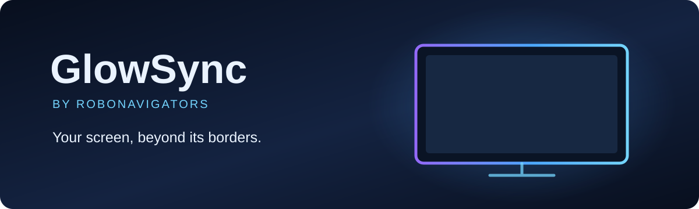
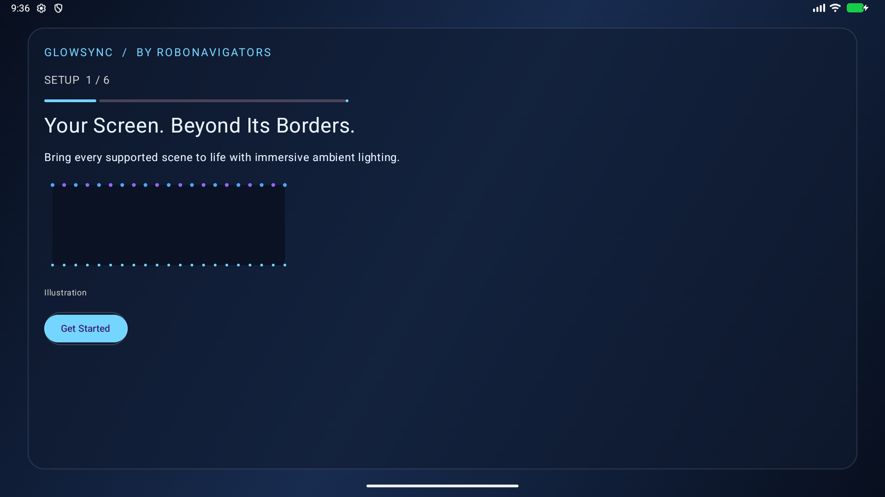
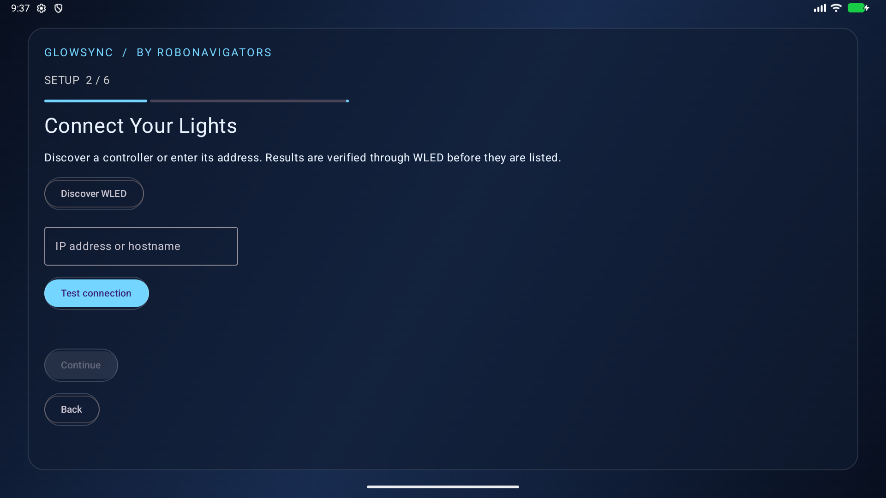
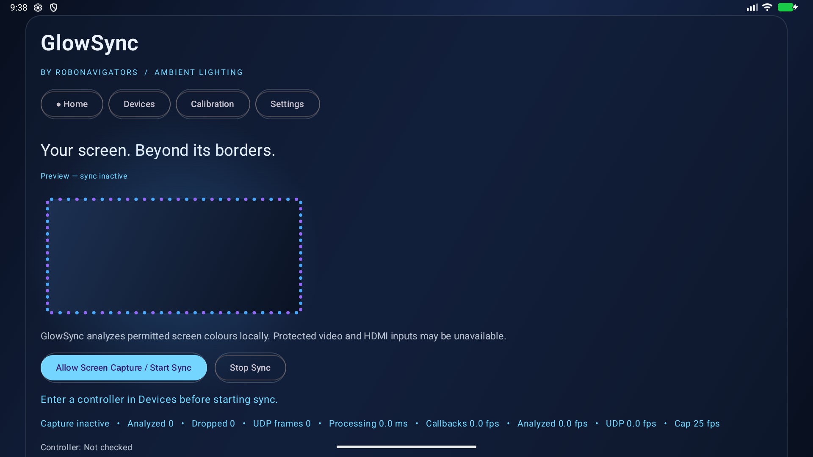
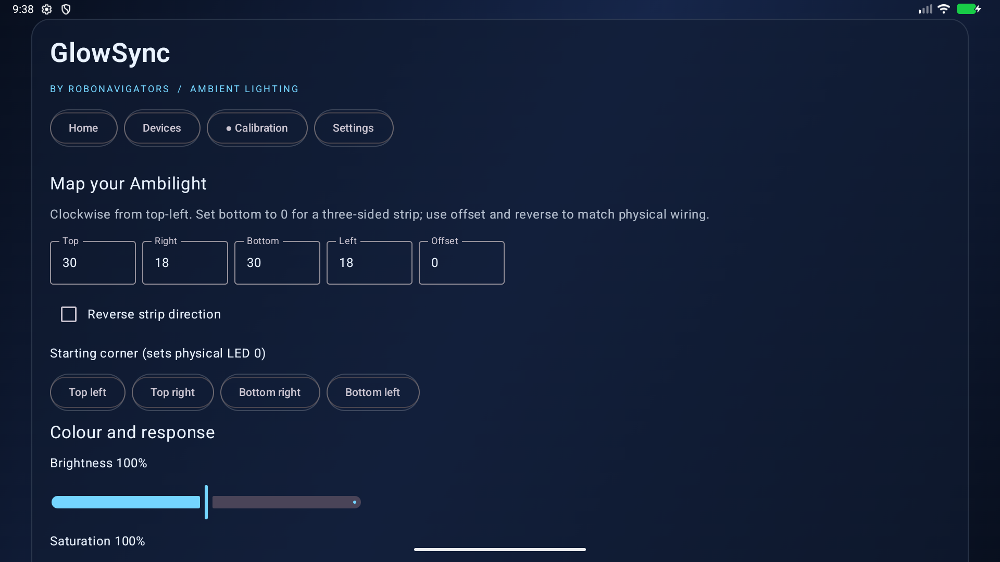

<p align="center"></p>

<p align="center">
  <a href="LICENSE"></a>
  
  
  
</p>

<p align="center"><strong>Ambient lighting for permitted screen content, processed locally on your TV.</strong></p>

GlowSync is a native Android TV and Google TV application that samples screen-edge colours and sends individual RGB values to a WLED controller. It uses Android's screen-capture permission and DDP over your local network. **It is an early development build, not a production-ready release.** Physical TV and WLED hardware have not yet been validated.

[Quick start](#quick-start) · [What it does](#what-it-does) · [Preview release](https://github.com/Robonavigators/GlowSync/releases/tag/v0.1.0-preview.1) · [Build and install](#build-and-install) · [Compatibility](#compatibility-and-limitations) · [Diagnostics](#diagnostics) · [Troubleshooting](docs/TROUBLESHOOTING.md) · [Contributing](CONTRIBUTING.md) · [Project layout](#project-layout)

## Start here

| You have | Start with |
|---|---|
| **Android TV / Google TV and a WLED controller** | [Quick start](#quick-start), then test the mapping before starting sync. |
| **A developer workstation** | [Build and install](#build-and-install) from the Android Studio project. |
| **An issue or a TV to test** | [Troubleshooting](docs/TROUBLESHOOTING.md) and [Contributing](CONTRIBUTING.md). |
| **A coding agent** | [AGENTS.md](AGENTS.md), [CODEX.md](CODEX.md), and the original [PROMPT.md](PROMPT.md). |

## How it works

| Step | What GlowSync does |
|---|---|
| **Connect** | Discovers WLED candidates or checks a manually entered IP/hostname via `/json/info`. |
| **Map** | Assigns colours to top, right, bottom and left LEDs, with offset and direction controls. |
| **Capture** | Requests Android's system screen-capture permission for each new session. |
| **Sync** | Samples a low-resolution frame locally and sends RGB24 DDP packets to the selected controller. |

The app does not save or upload screen frames. WLED HTTP and DDP are unencrypted: use a trusted local network. A UDP send does **not** confirm that a controller received or displayed a frame.

## Quick start

1. Put your Android TV or Google TV and WLED controller on a reachable local network. Enable WLED real-time DDP input and connect an addressable RGB strip.
2. [Build and install](#build-and-install) GlowSync, open it on the TV, then discover the controller or enter its IP address and test the connection. If verification fails, the app suggests checks for the address and local network.
3. Enter the LED count for each side. Set the bottom count to zero for a three-sided strip. Use the marker test, direction and offset to match the physical wiring.
4. Accept Android's real screen-capture prompt. Adjust brightness, saturation, edge depth, white balance and smoothing in calibration.
5. Start sync. Stop it from the app or foreground notification. Changing controllers requires a new capture session and fresh permission.

When capture is unavailable, the standalone LED test still works. Dark scenes and blocked content can look identical; the optional dark-frame fallback also affects genuinely dark scenes.

## What it does

| Area | Current implementation |
|---|---|
| **TV interface** | Compose setup flow and Home, Devices, Calibration and Settings sections with D-pad focus indicators. |
| **WLED** | Local discovery, manual address, verification, saved controllers and single-controller RGB24 DDP streaming. |
| **LED layout** | Per-side counts, clockwise/counterclockwise ordering, offset, starting-corner controls and a one-LED marker. |
| **Colour** | Average or weighted edge sampling, brightness, saturation, RGB and per-side correction, smoothing and conservative black-bar detection. |
| **Performance** | Conflated latest-frame output, configurable FPS targets, adaptive rate/resolution and measured app-side timings. |
| **Diagnostics** | Computed LED-colour preview, UDP counters, a direct-UDP response pattern and a field for externally measured latency. |

## Build and install

Requirements: JDK 17 or newer, Android SDK 35, and Android Studio or the included Gradle wrapper.

```sh
git clone https://github.com/Robonavigators/GlowSync.git
cd GlowSync
./gradlew testDebugUnitTest lintDebug assembleDebug
adb install -r app/build/outputs/apk/debug/app-debug.apk
```

Open the project in Android Studio if you prefer a graphical workflow. ADB installation requires a previously authorized connection to your TV. A debug APK is available temporarily as the [GitHub Actions artifact for this preview](https://github.com/Robonavigators/GlowSync/actions/runs/41087651449) until 2027-01-28; it is not a permanent APK release.

## Screenshots

These are captures of the running app on an Android emulator configured with a landscape display. No physical TV or WLED controller was connected; the dashboard lights shown here are the app's clearly labelled inactive preview.

| Setup welcome | WLED connection setup |
|---|---|
|  |  |
| Home with sync inactive | LED layout and calibration |
|  |  |

The Devices page is also shown in [this emulator capture](docs/screenshots/devices.png). These images document the interface, not physical controller connectivity or LED output.

## Compatibility and limitations

- The app targets Android 8 (API 26) and later and is currently built against API 35. Raising the target to API 37 requires reviewing the platform's local-network permission requirements.
- Android can block DRM-protected content, secure windows and HDMI inputs. GlowSync does not bypass those protections, and a black capture cannot reliably be classified as protected content.
- TV firmware controls MediaProjection behavior. A session can be revoked, cannot silently restart after process death, and needs fresh consent. Screen sleep stops the service; resize support depends on Android callbacks and device behavior.
- Multiple verified controllers can be saved; one is streamed to at a time. WLED connectivity is checked separately from the streaming loop, and UDP has no acknowledgement.
- The interface, full lifecycle coverage, accessibility and performance require physical-TV validation. No physical screen-to-LED latency has been measured, and 60 FPS is not guaranteed.

See [Troubleshooting](docs/TROUBLESHOOTING.md) for network, capture and mapping checks.

## Diagnostics

The dashboard distinguishes app processing, encoding, UDP call time and frame age. These numbers do not measure visible LED response.

For a direct response test, stop sync and open **Settings → Open response test**. It switches the screen pattern and sends a matching UDP frame. Film the screen and LEDs together with a high-speed camera or use photodiodes; compare the visible transitions and optionally save your externally measured value in Settings. This direct test **bypasses screen capture**. To measure the complete sync path, run GlowSync, show a test pattern in another app, and measure the screen and LEDs together.

## Tests and validation

```sh
./gradlew testDebugUnitTest lintDebug assembleDebug
./gradlew connectedDebugAndroidTest  # requires an attached device or emulator
```

The available JVM tests cover packet encoding, mapping, colour processing, adaptive policies and diagnostics. Android instrumentation has exercised consent, loopback DDP, backgrounding, activity recreation, calibration, the stop action and navigation on an API 37 phone emulator. Those tests are not a substitute for a consumer TV and WLED controller. System-dialog tests use English labels and may need adaptation for other versions or locales.

## Project layout

| Directory | Contents |
|---|---|
| [app/](app/) | Native Android TV app, capture and WLED pipeline, and automated tests. |
| [docs/](docs/) | Architecture, privacy, performance, troubleshooting and a hardware report template. |
| [tools/](tools/) | Optional build-and-install helpers for an authorized ADB connection. |
| [examples/](examples/) | Illustrative LED layouts and physical mapping guidance. |
| [tests/](tests/) | Test locations and commands. |
| [themes/](themes/) and [addons/](addons/) | Current appearance and extension boundaries; no installable themes or add-on API exist yet. |

[FAQ](docs/faq.md) · [Remote](docs/REMOTE.md) · [Calibration](docs/calibration.md) · [Capture](docs/capture.md) · [WLED](docs/wled.md) · [Architecture](docs/architecture.md) · [Performance](docs/performance.md) · [Privacy](docs/privacy.md) · [Device reports](docs/devices/README.md) · [Showcase](SHOWCASE.md)

## Privacy and contributing

Screen frames stay in memory on the TV and are not saved or uploaded. Configuration is stored locally; there is no account, subscription or analytics system. See [CONTRIBUTING.md](CONTRIBUTING.md), [CONTRIBUTORS.md](CONTRIBUTORS.md), [SECURITY.md](SECURITY.md), and [AGENTS.md](AGENTS.md). GlowSync is available under the [MIT license](LICENSE).
